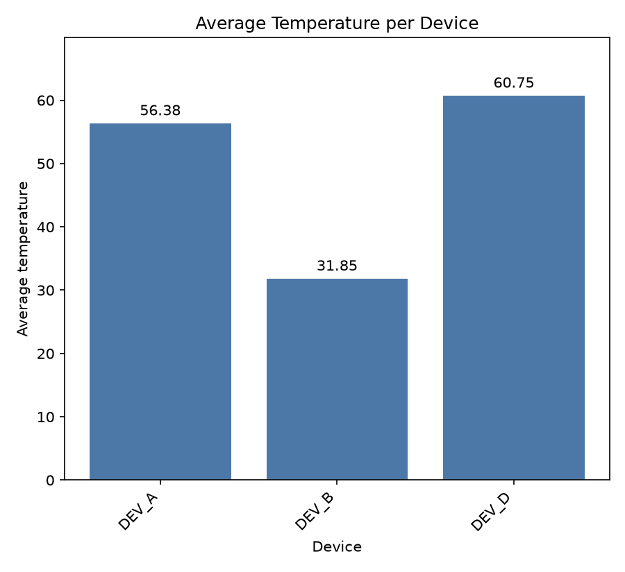

# Device Log Summarizer

A small CLI that reads device telemetry from a CSV file, summarizes it per device, and exports
the results as JSON. A separate script turns that JSON into a bar chart.

## 📂 Generated Outputs

All generated files are available in the `output/` directory:

| File | Description |
|---|---|
| `summary.json` | Aggregated device statistics, including record counts, average temperatures, and error counts. |
| `avg_temperature.png` | Bar chart comparing average temperatures across the filtered devices. |

### Sample Visualization



### Sample JSON Output

See [`output/summary.json`](output/summary.json) for the complete aggregated results.

## Setup

Requires Python 3.10+. The core tool has no dependencies; the chart and tests need two packages.

Create and activate a virtual environment before installing the optional dependencies:

```powershell
python -m venv .venv
# Windows PowerShell
.venv\Scripts\Activate.ps1
# Windows Command Prompt: .venv\Scripts\activate.bat
# macOS/Linux: source .venv/bin/activate
python -m pip install --upgrade pip
```

With the virtual environment activated, install the project dependencies:

```bash
python -m pip install -e ".[viz,dev]"
```

## Usage

```bash
# 1. Summarize telemetry (prints a table, writes output/summary.json)
python -m devlog data/device_telemetry.csv

# 2. Plot average temperature per device (writes output/avg_temperature.png)
python -m devlog.charts
```

Options for step 1:

| Flag | Default | Meaning |
|---|---|---|
| `-o`, `--output` | `output/summary.json` | where to write the JSON |
| `--max-avg` | `80.0` | drop devices whose average temperature is above this |

Options for step 2: `python -m devlog.charts [input.json] [-o chart.png]`.

Exit code is `0` on success and `1` on a file error (missing input, unwritable output).

## What it does

1. **Ingest** the CSV (`device_id`, `status`, `temperature`). Malformed rows (bad temperature,
   unknown status, blank device) are skipped and reported on stderr with their line numbers.
2. **Aggregate** per device: record count, mean temperature, number of `ERROR` records.
3. **Filter** out devices whose mean temperature is above 80.0 (exactly 80.0 is kept).
4. **Export** to JSON (averages rounded to 2 decimals) and print a summary table.

`devlog/sanitize.py` holds the standalone Section 1 function, `clean_readings`.

## Project layout

```
data/device_telemetry.csv   sample input (includes a few deliberately bad rows)
output/summary.json         sample output
output/avg_temperature.png  sample chart
devlog/
  models.py                 TelemetryRecord, DeviceSummary, Status
  sanitize.py               clean_readings (Section 1)
  ingest.py                 CSV -> records, skipped-row reporting
  aggregate.py              grouping, statistics, filtering
  export.py                 JSON output
  report.py                 terminal table
  cli.py                    argparse entry point (python -m devlog)
  charts.py                 matplotlib chart (python -m devlog.charts)
tests/                      pytest suite, one file per module
PROMPT_LOG.md               how AI tools were used
```

## Tests

```bash
python -m pytest
```

Chart tests are skipped automatically if matplotlib isn't installed.

## Assumptions

- Negative temperatures in the CSV are treated as valid readings, not error flags.
- Status values are matched case-insensitively; device IDs are matched exactly (after trimming).
- If no valid rows remain, the tool still succeeds and writes `{"devices": []}`.
